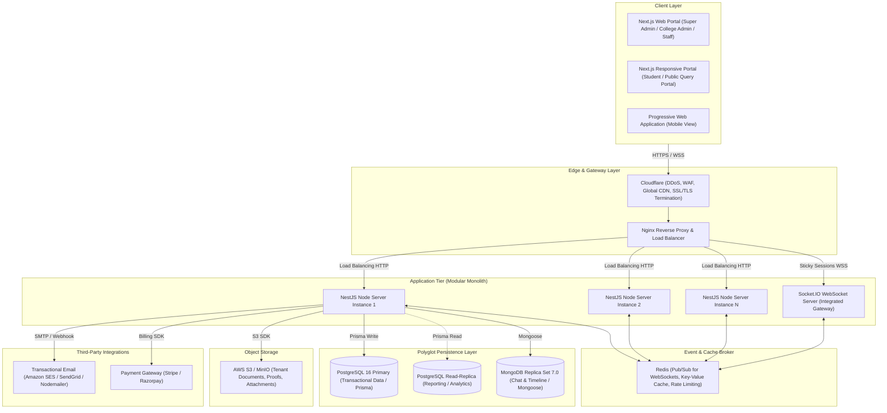

# 01. Complete System Architecture — CollegeQuery SaaS

## 1. Executive Summary

**CollegeQuery** is an enterprise-grade, multi-tenant Software-as-a-Service (SaaS) platform engineered to streamline, govern, and accelerate academic, administrative, and student support inquiries across independent colleges and universities.

The platform employs a **hybrid polyglot persistence architecture**:
- **PostgreSQL (via Prisma ORM)** acts as the strictly-consistent relational source of truth for all transactional business entities (tenants, colleges, users, roles, permissions, academic hierarchies, query tickets, SLAs, and subscriptions).
- **MongoDB (via Mongoose ODM)** acts as the horizontally-scalable, flexible document store for high-volume conversational threads, message timelines, read receipts, and real-time activity events.
- **Redis** operates as the low-latency cache, distributed pub/sub broker for horizontal WebSocket scaling across cluster nodes, session/token blacklist, and rate-limiting store.

---

## 2. High-Level System Architecture Diagram

---

## 3. Core Architectural Principles

1. **Modular Monolith First**:
   - Organized into highly decoupled NestJS feature modules communicating through direct service injection, domain events (`@nestjs/event-emitter`), or clean internal interfaces.
   - Preserves low latency, atomic transactional integrity where needed, simplified local development, and unified CI/CD while retaining modular boundaries that enable zero-downtime microservice extraction if needed at extreme scale.

2. **Strict Multi-Tenant Isolation**:
   - Shared Database, Shared Schema architecture with guaranteed tenant data boundaries.
   - Every single relational and document entity is tagged with an immutable `tenantId`.
   - Security enforced at multiple checkpoints: TLS subdomain / header resolution, authentication guard validation, tenant membership verification, and tenant-aware repository query filtering.

3. **Hybrid Polyglot Data Strategy**:
   - **Structured, ACID-dependent data**: Stored in PostgreSQL with relational foreign keys, cascade constraints, composite unique indexes (`[tenantId, code]`), and transaction blocks.
   - **High-throughput append-only data**: Conversation history, dynamic metadata payloads, and read receipts stored in MongoDB to avoid table bloat and high write locks on relational ticket tables.

4. **Real-time Event-Driven Collaboration**:
   - WebSocket connections authenticated via short-lived JWTs.
   - Socket rooms partitioned strictly by tenant and query ID: `tenant:${tenantId}:query:${queryId}`.
   - Redis Pub/Sub adapter guarantees horizontal message delivery across auto-scaling backend instances.

5. **Defense-in-Depth Security**:
   - Cryptographic validation of access tokens (15-minute lifespan).
   - Rotating refresh tokens stored in hashed format in PostgreSQL with revocation capabilities.
   - Zero-trust RBAC with dynamic role-permission matrix evaluated via custom metadata decorators and guards.
