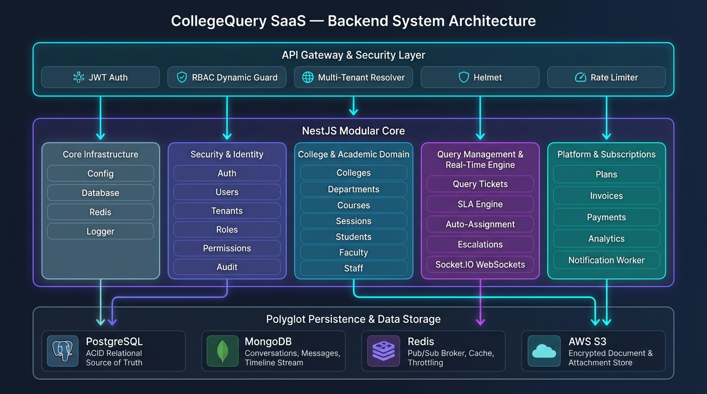
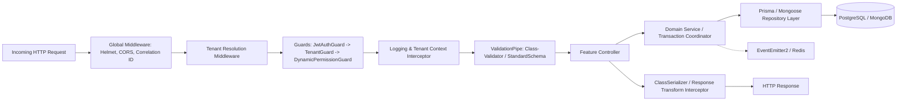

# 02. Backend Modular Architecture — CollegeQuery SaaS

## 1. Overview & Architectural Boundaries

The CollegeQuery backend is implemented as a **Modular Monolith** using NestJS, TypeScript, Prisma ORM, and Mongoose ODM. Each business domain is encapsulated in its own module following the Single Responsibility Principle, Dependency Inversion, and Domain-Driven Design (DDD) layering.

---

## 2. Visual Architecture Diagram



> Vector SVG version with interactive elements is available at: [backend-architecture.svg](./assets/backend-architecture.svg)

---

## 3. Backend Module Dependency & Layering Diagram

```mermaid
flowchart TD
    subgraph CoreLayer["Core Infrastructure Layer (Global)"]
        ConfigMod["ConfigModule (@nestjs/config)"]
        DatabaseMod["DatabaseModule (PrismaService + MongooseModule)"]
        RedisMod["RedisModule (Cache + Pub/Sub)"]
        LoggerMod["LoggerModule (Winston / Pino Structured Logging)"]
        HealthMod["HealthModule (@nestjs/terminus)"]
    end

    subgraph SecurityLayer["Security & Identity Layer"]
        AuthMod["AuthenticationModule (JWT, Refresh Token Rotation, Argon2)"]
        TenantMod["TenantModule (Tenant Context & Resolution Middleware)"]
        RBACMod["RBACModule (Roles, Permissions & Dynamic Policy Guards)"]
        AuditMod["AuditLogModule (Comprehensive Action Trails)"]
    end

    subgraph CollegeDomainLayer["College Hierarchy & Academic Management"]
        UsersMod["UsersModule"]
        CollegesMod["CollegesModule"]
        DeptsMod["DepartmentsModule"]
        CoursesMod["CoursesModule"]
        SessionsMod["AcademicSessionsModule"]
        FacultyMod["FacultyModule"]
        StudentsMod["StudentsModule"]
        EmployeesMod["EmployeesModule"]
    end

    subgraph QueryDomainLayer["Query & Collaboration Engine"]
        QueryTicketMod["QueryManagementModule (Tickets, Lifecycle, Status)"]
        QueryCategoryMod["QueryCategoryModule (Routing Rules, Workflows)"]
        AssignmentMod["QueryAssignmentModule (Auto & Manual Routing)"]
        EscalationMod["QueryEscalationModule (SLA Timers & Breaches)"]
        ConversationMod["ConversationModule (MongoDB Chat Engine)"]
        MessagingMod["MessagingModule (Socket.IO Gateway & Rooms)"]
        AttachmentMod["AttachmentModule (S3 / Presigned URLs)"]
        SLAMod["SLAManagementModule"]
        FeedbackMod["FeedbackModule (CSAT, Ratings)"]
        KBMod["KnowledgeBaseModule (Articles & FAQs)"]
    end

    subgraph PlatformLayer["Platform Admin, Subscriptions & Notifications"]
        NotificationMod["NotificationModule (In-App Alerts)"]
        EmailMod["EmailModule (SES / Nodemailer Templates)"]
        SubscriptionMod["SubscriptionModule (Plans, Quotas)"]
        BillingMod["BillingModule (Invoices & Payment Gateway)"]
        AnalyticsMod["AnalyticsModule (Metrics & Performance)"]
        ReportsMod["ReportsModule (Export CSV / PDF)"]
        SysAdminMod["SystemAdminModule (Super Admin Controls)"]
    end

    SecurityLayer --> CoreLayer
    CollegeDomainLayer --> SecurityLayer
    QueryDomainLayer --> CollegeDomainLayer
    QueryDomainLayer --> SecurityLayer
    PlatformLayer --> SecurityLayer
    PlatformLayer --> CollegeDomainLayer
```



---

## 3. Detailed Modules & Responsibilities Matrix

| Module | Core Responsibilities | Database Scope |
| :--- | :--- | :--- |
| **AuthenticationModule** | Issue access/refresh tokens, token rotation, login rate-limiting, password resets, MFA. | PostgreSQL (`users`, `refresh_tokens`) |
| **TenantModule** | Resolve tenant from hostname or `x-tenant-id`, populate `TenantContext`, block cross-tenant leakage. | PostgreSQL (`tenants`, `tenant_configs`) |
| **RBACModule** | Manage system & tenant roles, granular permissions, role inheritance, and permission guards. | PostgreSQL (`roles`, `permissions`, `role_permissions`) |
| **UsersModule** | User profile lifecycle, user activation/deactivation, credential storage. | PostgreSQL (`users`) |
| **CollegesModule** | Multi-campus metadata, address, contact, branding, theme configuration. | PostgreSQL (`colleges`, `campus_units`) |
| **DepartmentsModule** | Department definitions, HOD assignment, query category associations. | PostgreSQL (`departments`) |
| **CoursesModule** | Degree programs, courses, year/semester configurations. | PostgreSQL (`courses`, `course_batches`) |
| **AcademicSessionsModule**| Academic year tracking (e.g., 2026-2027), active session demarcation. | PostgreSQL (`academic_sessions`) |
| **StudentsModule** | Student enrollment details, roll numbers, assigned department and course batch. | PostgreSQL (`students`) |
| **FacultyModule** | Faculty designations, department mapping, query handling capacity. | PostgreSQL (`faculty`) |
| **EmployeesModule** | Non-teaching staff (accounts, examination, reception, support) mapping. | PostgreSQL (`employees`) |
| **QueryCategoryModule** | Categorization tree (Fees, Exams, Academics, Hostel), SLA defaults, routing presets. | PostgreSQL (`query_categories`) |
| **QueryManagementModule**| Ticket lifecycle (Open, In_Progress, Escalated, Resolved, Closed), priority, metadata. | PostgreSQL (`queries`, `query_status_history`) |
| **QueryAssignmentModule**| Auto-routing based on category/department, manual reassignment, workload balancing. | PostgreSQL (`query_assignments`) |
| **QueryEscalationModule**| Monitors SLA threshold triggers; escalates ticket level (e.g., Faculty -> HOD -> Principal). | PostgreSQL (`query_escalations`, `sla_policies`) |
| **ConversationModule** | Chat threads, threaded replies, system timeline events, rich text messages. | **MongoDB** (`conversations`, `messages`, `activity_events`) |
| **MessagingModule** | Socket.IO gateway, real-time message broadcasting, room management, typing indicators. | Memory / Redis Pub/Sub |
| **AttachmentModule** | Secure S3 presigned URL generation, file validation, virus scan trigger, attachment linking. | PostgreSQL (`attachments`) + S3 |
| **SLAManagementModule** | Service Level Agreement definitions, working hours/holiday calendar logic, breach calculation.| PostgreSQL (`sla_policies`, `sla_schedules`) |
| **FeedbackModule** | Post-resolution student feedback, 5-star ratings, NPS metrics, resolution sentiments. | PostgreSQL (`query_feedback`) |
| **KnowledgeBaseModule** | Internal & student-facing articles, FAQs, category tagging to deflect redundant tickets. | PostgreSQL (`kb_articles`, `faqs`) |
| **NotificationModule** | User in-app notifications, unread badges, push notification dispatcher. | PostgreSQL (`notifications`) |
| **EmailModule** | Email queue processing (BullMQ / direct), template engine (Handlebars), transactional delivery. | External SMTP |
| **SubscriptionModule** | Plan tiers (Starter, Campus Pro, Enterprise), seat limits, feature flags. | PostgreSQL (`plans`, `subscriptions`) |
| **BillingModule** | Invoices, payment records, webhook ingestion from Stripe/Razorpay. | PostgreSQL (`invoices`, `payments`) |
| **AuditLogModule** | Immutable audit records for sensitive actions (user login, role change, data export). | PostgreSQL (`audit_logs`) |
| **AnalyticsModule** | Aggregations: query resolution rate, SLA breach percentage, faculty response times. | PostgreSQL (Read Replica) |
| **ReportsModule** | Asynchronous CSV/Excel/PDF generation for compliance, exports, and audits. | Worker / Temporary S3 |
| **SystemAdminModule** | Super Admin cross-tenant dashboard, tenant provisioning, system health, platform metrics. | PostgreSQL (Global Scope) |

---

## 4. NestJS Clean Architecture Pipeline

Every inbound HTTP request flows through a unified request-response lifecycle:



---

## 5. Error Handling & Standardized Response Envelope

All controllers return responses adhering to the **JSend / Enterprise JSON Envelope**:

### Success Format:
```json
{
  "success": true,
  "statusCode": 200,
  "message": "Query ticket retrieved successfully",
  "data": {
    "id": "uuid-here",
    "ticketNumber": "CQ-2026-00412",
    "status": "IN_PROGRESS"
  },
  "meta": {
    "timestamp": "2026-11-25T18:00:00.000Z",
    "correlationId": "req-98fbc1-32"
  }
}
```

### Error Format:
```json
{
  "success": false,
  "statusCode": 403,
  "errorCode": "FORBIDDEN_TENANT_ACCESS",
  "message": "You do not have access rights to queries belonging to tenant 'acme-univ'",
  "errors": [],
  "meta": {
    "timestamp": "2026-11-25T18:00:00.000Z",
    "correlationId": "req-98fbc1-32",
    "path": "/api/v1/queries/CQ-2026-00412"
  }
}
```
