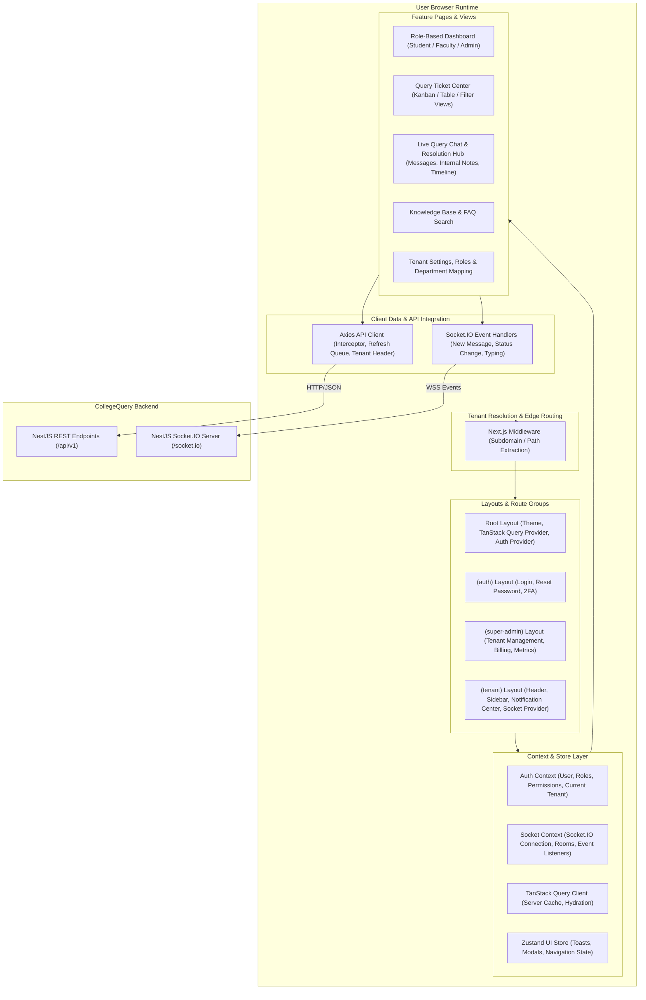
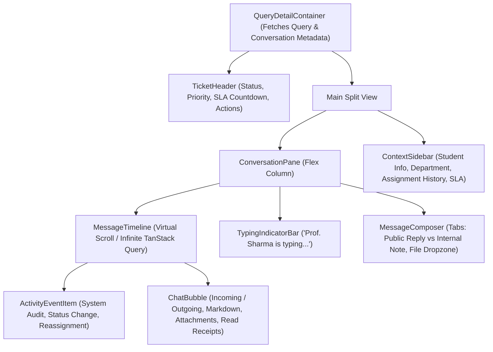

# 03. Frontend Architecture — CollegeQuery SaaS

## 1. Frontend Technology Stack & Rationale

- **Framework**: Next.js 14+ (App Router, Server Components + Client Islands).
- **Language**: TypeScript (strict mode enabled).
- **Styling**: Bootstrap 5 + SCSS Custom Modules + Bootstrap Icons.
- **Server State & Data Fetching**: TanStack Query (React Query v5) for automated caching, deduplication, optimistic updates, and background revalidation.
- **HTTP Client**: Axios with centralized request/response interceptors for token refresh and tenant injection.
- **Real-Time Client**: Socket.IO Client with automatic reconnection, heartbeat, and room subscription management.
- **Client State**: Zustand for UI states (sidebar toggle, active modals, chat draft states).
- **Forms & Validation**: React Hook Form + Zod / Standard Schema for type-safe form validation.

---

## 2. Frontend Architecture Diagram



---

## 3. Multi-Tenant Subdomain Routing Strategy

Tenants access the portal using two supported URL topologies:
1. **Subdomain-based (Preferred for production)**:
   - Super Admin: `admin.collegequery.com`
   - College A (Acme Engineering): `acme.collegequery.com`
   - College B (St. Jude University): `stjude.collegequery.com`
2. **Path-based (Development fallback)**:
   - `collegequery.com/tenants/:tenantSlug`

### Next.js Edge Middleware Workflow:
```typescript
// Conceptual Middleware Execution:
// 1. Extract hostname from req.headers.get('host')
// 2. Parse subdomain: e.g. "acme" from "acme.collegequery.com"
// 3. Rewrite request internally to /(tenant)/[tenantSlug]/...
// 4. Attach 'x-tenant-slug' header to the forwarded request
```

---

## 4. Real-Time Conversation Component Hierarchy

The query conversation interface is designed for low latency, optimistic messaging, and instant delivery indicators:



---

## 5. Security & Authentication Flow in Next.js

1. **Token Storage**:
   - `accessToken`: Maintained strictly in memory or short-lived secure memory store to prevent XSS exfiltration.
   - `refreshToken`: Stored in a secure `HttpOnly`, `SameSite=Strict`, `Secure` cookie set directly by the NestJS backend.
2. **Silent Refresh Interceptor**:
   - Axios response interceptor intercepts `401 Unauthorized`.
   - Queues pending requests while issuing a single refresh request to `/api/v1/auth/refresh-token`.
   - On refresh success, replays all queued requests with the new token.
   - On refresh failure, clears state and redirects the user to `/auth/login` with redirect parameters.
3. **Role & Permission Directives**:
   - Custom `<Can I="query:reassign" a="Query">` wrapper component conditionally renders administrative actions without exposing forbidden buttons or forms to unauthorized roles.
