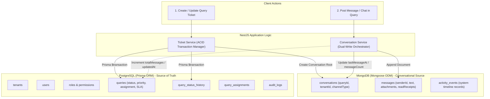
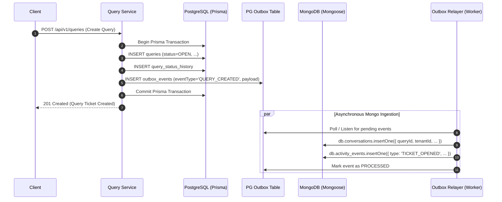

# 04. Database Architecture & Polyglot Persistence Strategy

## 1. High-Level Polyglot Architecture

CollegeQuery separates concerns between **strictly transactional operational records** and **high-velocity conversational records**:

---

## 2. Source of Truth Demarcation

| Domain Entity | Primary Store | Storage Format | Justification |
| :--- | :--- | :--- | :--- |
| **Tenants, Subscriptions, Plans** | PostgreSQL | Relational | Strict relational integrity, billing compliance, financial ACID transactions. |
| **Users, Roles, Permissions** | PostgreSQL | Relational | Foreign key integrity with tenant boundaries; rapid role checks via index joins. |
| **Colleges, Depts, Courses, Students, Faculty** | PostgreSQL | Relational | Hierarchical integrity: student belongs to course, course to department, department to college. |
| **Query Tickets & Metadata** | PostgreSQL | Relational | Status machine, SLA timestamps, indexed filtering by status, priority, and assigned faculty. |
| **Query Assignments & SLA Status** | PostgreSQL | Relational | Historical auditing, relational metrics, timestamp precision for breach calculations. |
| **Conversation Threads & Messages**| **MongoDB** | JSON Document | Variable length text, rich text formatting, nested read receipts, dynamic media payloads. |
| **System Timeline Events** | **MongoDB** | JSON Document | Append-only event stream of fine-grained activity without burdening PostgreSQL table sizes. |
| **File / Media Content** | AWS S3 / MinIO | Object Blob | Scalable binary object storage; URLs stored in PostgreSQL and MongoDB. |

---

## 3. Cross-Database Identification & Integrity Strategy

Relational and document records are tied together using immutable UUIDv7 / UUIDv4 identifiers:

1. **`tenantId` (UUID)**: Present on **every** PostgreSQL table and **every** MongoDB collection. MongoDB collections have compound indexes starting with `tenantId`.
2. **`queryId` (UUID)**: The primary key of the PostgreSQL `queries` table is stored as an indexed field `queryId` in the MongoDB `conversations`, `messages`, and `activity_events` collections.
3. **`conversationId` (ObjectId / UUID string)**: Stored as `conversationRefId` in the PostgreSQL `queries` table to allow direct point-lookup navigation.
4. **`senderId` / `userId` (UUID)**: The PostgreSQL `users.id` is stamped onto all MongoDB message records.

---

## 4. Dual-Write Consistency & Failure-Handling Strategy

When an operation requires coordination across PostgreSQL and MongoDB (for example: creating a new query ticket and initializing its conversation thread):

### Failure Handling Guarantees:
- **Transactional Outbox Pattern**: PostgreSQL transaction atomically writes the query record and an `outbox_events` record. If the database crashes, neither is committed.
- **Idempotency in MongoDB**: MongoDB collections enforce a unique index on `{ queryId: 1, type: 1 }` for conversation roots. Duplicate outbox events re-deliver safely without creating duplicate chat threads.
- **Reconciliation Job**: A lightweight cron job runs every 15 minutes comparing newly created PostgreSQL queries with MongoDB conversations, re-dispatching any unlinked conversation documents.
