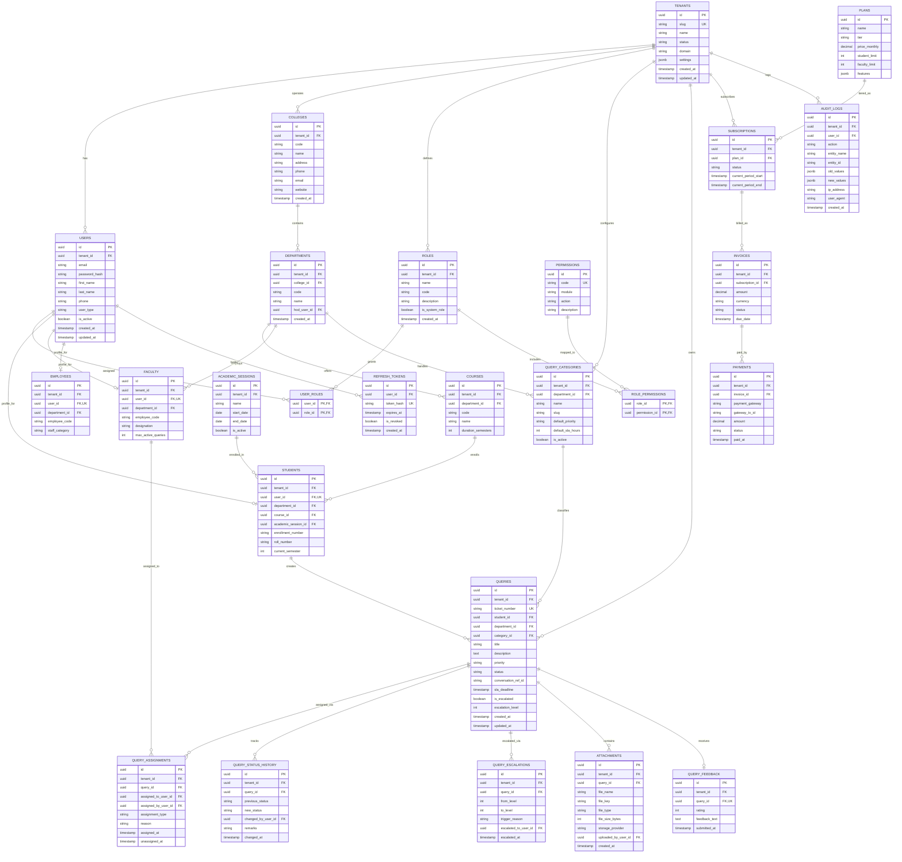

# 05. PostgreSQL Relational Entity-Relationship Diagram

## 1. Overview

The PostgreSQL database (managed via Prisma ORM) enforces ACID consistency, strict foreign keys, multi-tenant scoping (`tenant_id`), cascading deletions, and composite uniqueness.

---

## 2. PostgreSQL ER Diagram (Mermaid)

