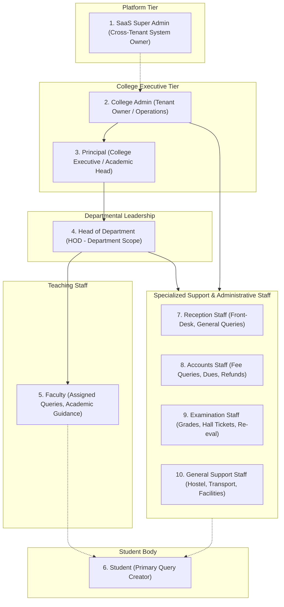

# 08. Role-Based Access Control (RBAC) Architecture

## 1. Principles of CollegeQuery Authorization

1. **Permission-Driven, Not Role-Driven**:
   - Controllers and services **never** hardcode checks like `if (user.role === 'HOD')`.
   - Instead, endpoints are annotated with required permissions: `@RequirePermissions('query:reassign', 'query:escalate')`.
2. **Dynamic & Configurable**:
   - Permissions are atomic system strings stored in the database.
   - Roles group permissions. While system default roles are pre-seeded, College Admins can adjust custom roles and assign granular permissions.
3. **Tenant-Scoped RBAC**:
   - Except for SaaS Super Admin, all roles and role assignments exist within a `tenantId`.

---

## 2. Role Hierarchy Diagram



---

## 3. Granular Permission Matrix

Permissions follow the format: `<module>:<resource>:<action>`

| Module | Permission Code | Description | Default Roles Assigned |
| :--- | :--- | :--- | :--- |
| **Queries** | `query:create` | Create a new query ticket | Student, Reception |
| | `query:view:own` | View queries created by self | Student |
| | `query:view:assigned` | View queries assigned to self | Faculty, Staff, HOD |
| | `query:view:department`| View all queries in assigned department | HOD, Faculty (optional) |
| | `query:view:all` | View all college queries across departments | College Admin, Principal |
| | `query:reply:public` | Post public message to student | Student, Faculty, Staff, HOD |
| | `query:reply:internal`| Post internal staff-only note | Faculty, Staff, HOD, Principal, Admin |
| | `query:assign` | Assign query to faculty/staff | HOD, College Admin, Principal |
| | `query:reassign` | Reassign query to another department/person | HOD, College Admin |
| | `query:escalate` | Manually escalate query level | Faculty, HOD, Principal |
| | `query:resolve` | Mark query as resolved | Assigned Faculty, HOD, Admin |
| | `query:close` | Permanently close ticket | Student (after resolution), Admin |
| | `query:reopen` | Reopen query within window | Student, College Admin |
| **SLA** | `sla:manage` | Configure SLA thresholds and working calendars| College Admin |
| | `sla:view_metrics`| View SLA breach reports | Principal, HOD, Admin |
| **Academic**| `department:manage`| Create/Edit departments and assign HOD | College Admin, Principal |
| | `course:manage` | Create courses, batches, and semesters | College Admin |
| | `student:enroll` | Bulk upload / enroll students | College Admin, Examination Staff |
| | `faculty:manage` | Manage faculty directory and capacity | College Admin, HOD |
| **Settings**| `tenant:settings:edit`| Modify college logo, branding, timezones | College Admin |
| | `roles:manage` | Create/edit custom roles and permission mappings| College Admin |
| **Platform**| `platform:tenants:manage`| Provision colleges, suspend tenants | SaaS Super Admin |
| | `platform:plans:manage` | Configure subscription pricing tiers | SaaS Super Admin |

---

## 4. Permission Decorator & Guard Implementation

### `@RequirePermissions` Decorator:
```typescript
import { SetMetadata } from '@nestjs/common';

export const PERMISSIONS_KEY = 'permissions';
export const RequirePermissions = (...permissions: string[]) =>
  SetMetadata(PERMISSIONS_KEY, permissions);
```

### `DynamicPermissionGuard`:
```typescript
@Injectable()
export class DynamicPermissionGuard implements CanActivate {
  constructor(private reflector: Reflector) {}

  canActivate(context: ExecutionContext): boolean {
    const requiredPermissions = this.reflector.getAllAndOverride<string[]>(
      PERMISSIONS_KEY,
      [context.getHandler(), context.getClass()],
    );

    if (!requiredPermissions || requiredPermissions.length === 0) {
      return true; // No explicit permission needed beyond authentication
    }

    const { user } = context.switchToHttp().getRequest();
    if (!user || !user.permissions) {
      throw new ForbiddenException('User lacks required permissions');
    }

    // Super Admin bypass
    if (user.isSuperAdmin) return true;

    // Verify user possesses all required permissions
    const hasPermission = requiredPermissions.every((perm) =>
      user.permissions.includes(perm),
    );

    if (!hasPermission) {
      throw new ForbiddenException(
        `Access denied. Requires permissions: ${requiredPermissions.join(', ')}`,
      );
    }

    return true;
  }
}
```

### Usage in Controller:
```typescript
@Controller('queries')
@UseGuards(JwtAuthGuard, TenantGuard, DynamicPermissionGuard)
export class QueryController {
  @Patch(':id/reassign')
  @RequirePermissions('query:reassign')
  async reassignTicket(@Param('id') id: string, @Body() dto: ReassignQueryDto) {
    return this.queryService.reassign(id, dto);
  }
}
```
