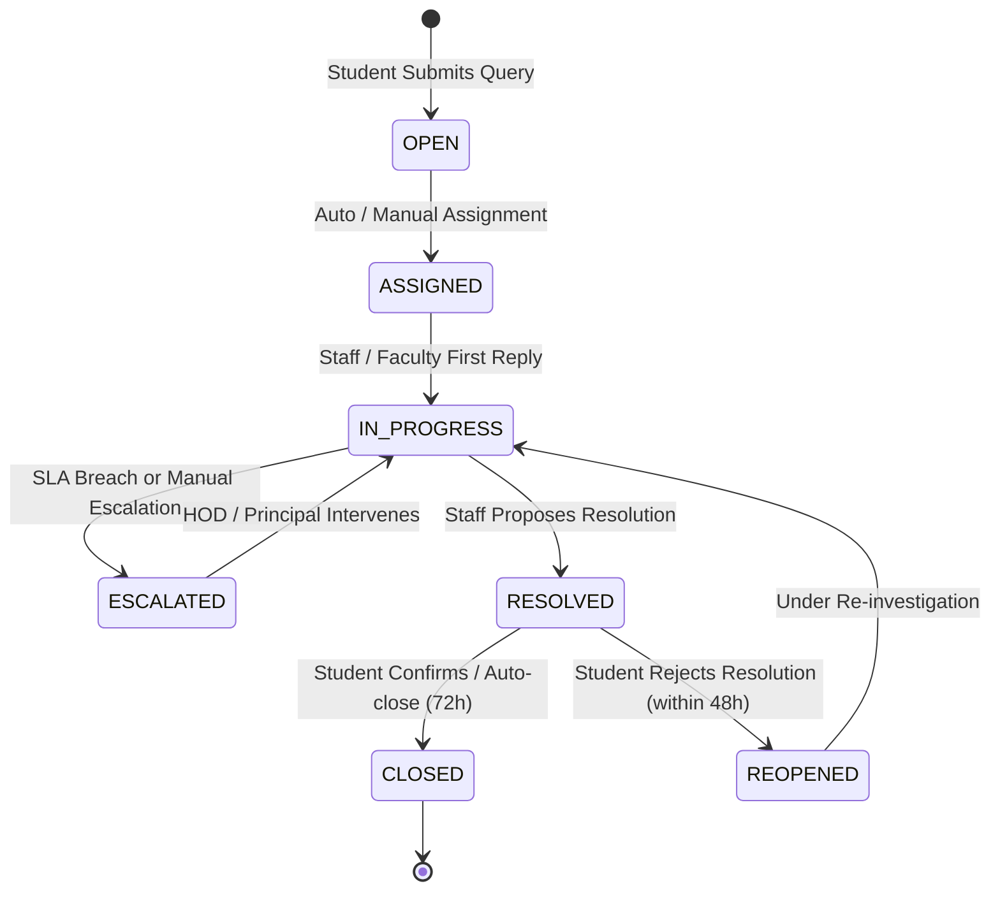
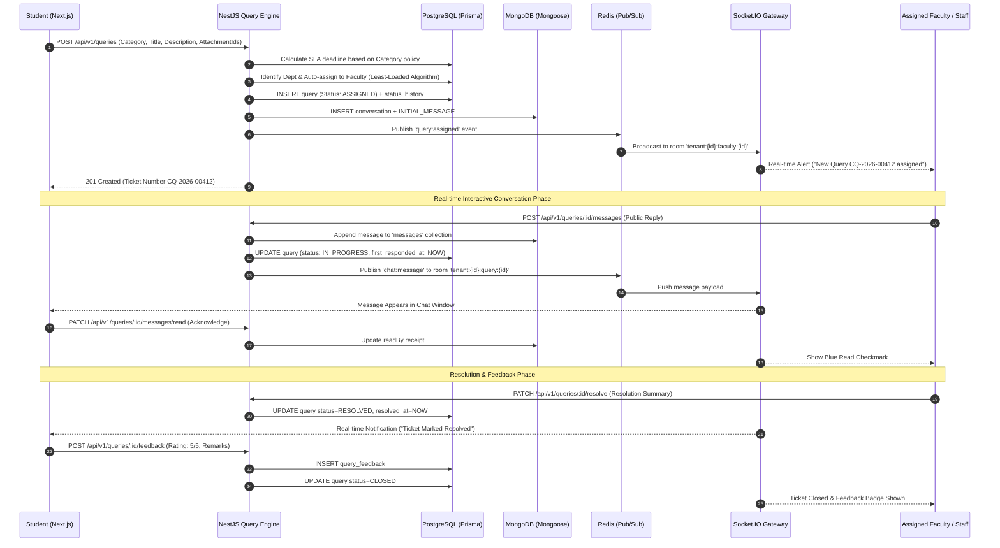
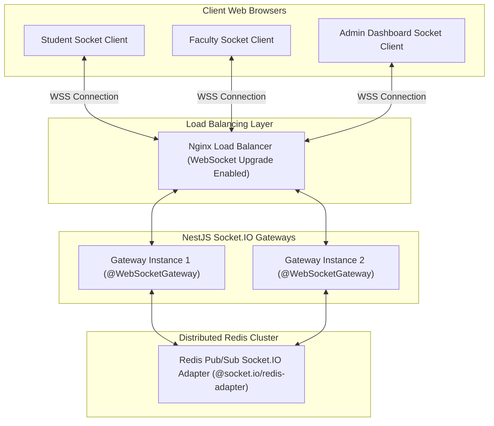

# 09. Query Lifecycle & Real-Time Communication Architecture

## 1. Query State Machine

A query ticket transitions through strictly validated lifecycle states:

---

## 2. End-to-End Query Lifecycle Sequence Diagram

---

## 3. Real-Time Messaging Architecture (Socket.IO + Redis Adapter)

### Socket Room Partitioning Strategy:
- **Tenant Scope**: `tenant:${tenantId}` (General college broadcasts).
- **User Scope**: `tenant:${tenantId}:user:${userId}` (Personal alerts, assignments).
- **Query Ticket Scope**: `tenant:${tenantId}:query:${queryId}` (Live chat stream, typing indicators).

### Socket Authentication Protocol:
1. Client connects with handshake auth:
   `io({ auth: { token: 'Bearer <JWT>' } })`
2. Gateway `canActivate` verifies JWT signature, extracts `tenantId`, `userId`, and `roles`.
3. Client is joined to authorized rooms only after tenant validation.
