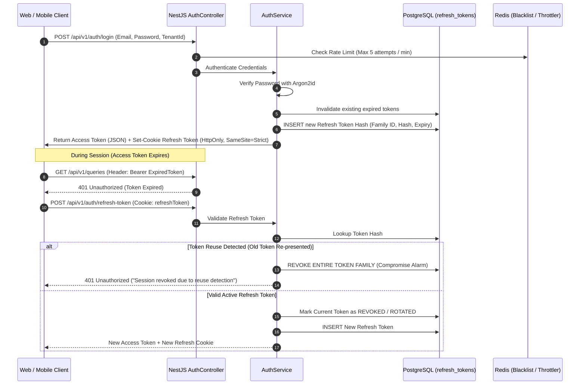
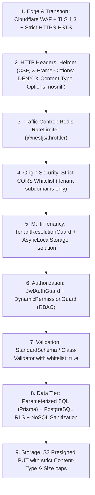

# 11. Security Architecture & Threat Mitigation

## 1. Authentication & Refresh Token Rotation Flow

CollegeQuery uses short-lived Access Tokens (15 minutes) paired with cryptographically secure, rotating Refresh Tokens (7 days) stored in PostgreSQL with token reuse detection.

---

## 2. Password Hashing Specification (Argon2id)

Passes OWASP recommendations for password storage using **Argon2id**:
- **Type**: `argon2id` (resistant against side-channel and GPU cracking attacks)
- **Memory Cost (`m`)**: 65,536 KiB (64 MiB)
- **Time Cost (`t`)**: 3 iterations
- **Parallelism (`p`)**: 4 threads
- **Salt**: 16 cryptographically secure random bytes generated per hash.

---

## 3. Defense-in-Depth Layered Security Matrix

---

## 4. Secure File Upload Pipeline

To prevent malicious executable files from reaching the server filesystem or executing in browsers:
1. **Presigned URL Architecture**: File binaries are uploaded **directly from client browser to S3**, bypassing the NestJS API application memory and disk.
2. **Strict MIME Whitelisting**:
   - Allowed: `image/jpeg`, `image/png`, `image/webp`, `application/pdf`, `text/plain`.
   - Disallowed: All executables (`.exe`, `.sh`, `.bat`, `.js`, `.html`, `.svg`).
3. **File Size Capping**: S3 Presigned PUT enforces `content-length-range` max 10MB per attachment.
4. **S3 Bucket Lockdown**:
   - S3 bucket has public access blocked completely.
   - All client downloads must go through signed GET URLs with 15-minute expiration and `Content-Disposition: attachment; filename="safe_name.ext"`.
