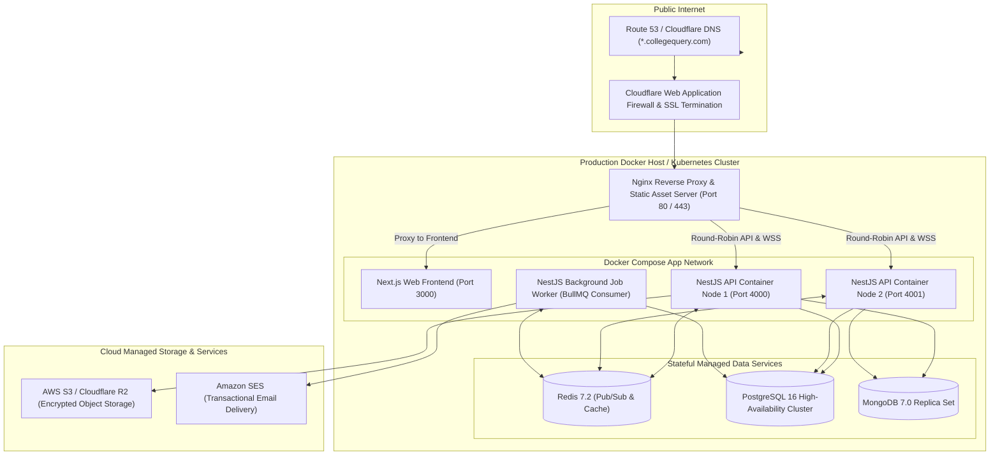
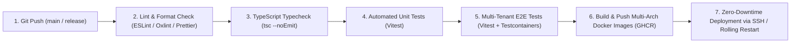

# 12. Deployment, Containerization & CI/CD Architecture

## 1. Cloud Deployment Architecture Diagram

---

## 2. Docker & Containerization Strategy

Multi-stage production Dockerfiles are created for both the NestJS API and Next.js frontend to minimize image sizes (Alpine base), eliminate development dependencies, and run under non-root system users.

### Docker Compose Architecture (`docker-compose.prod.yml`):
- `nginx`: Ingress reverse proxy with HTTP/2 and WebSocket upgrade support.
- `api`: Replicated NestJS service instances running in cluster mode.
- `worker`: Standalone instance dedicated to processing queue jobs (emails, reports, SLA checks).
- `web`: Next.js standalone output image.
- `redis`: In-memory data store with AOF persistence.
- `postgres`: PostgreSQL 16 Alpine with initialized RLS extensions.
- `mongo`: MongoDB 7.0 with replica set enabled for change streams.

---

## 3. GitHub Actions CI/CD Pipeline

