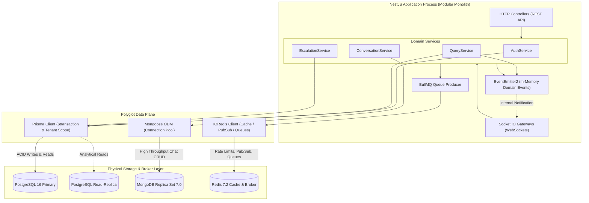

# 14. Inter-Service & Database Communication Flow

## 1. Overview & Communication Matrix

Within the CollegeQuery modular monolith, communication between bounded contexts and data stores is designed to prevent tight coupling while preserving high performance and transaction safety.

---

## 2. Database Communication Flow Diagram



---

## 3. Communication Patterns

### 3.1 In-Process Domain Events (`@nestjs/event-emitter`)
When an action in one module triggers side-effects in another without requiring immediate transactional consistency (e.g., ticket creation triggers notification and email dispatch):
```typescript
// QueryService:
this.eventEmitter.emit(
  'query.created',
  new QueryCreatedEvent(tenantId, query.id, studentId, departmentId),
);

// NotificationModule:
@OnEvent('query.created', { async: true })
async handleQueryCreated(event: QueryCreatedEvent) {
  await this.notificationService.notifyDepartmentStaff(event);
}
```

### 3.2 Asynchronous Background Queues (BullMQ + Redis)
Time-consuming or external I/O bound tasks are offloaded to Redis queues processed by worker processes:
- **Email Delivery Queue**: Transactional email dispatch with exponential backoff retries.
- **SLA Monitor Queue**: Recurring job checking ticket deadlines and escalating overdue tickets.
- **Export Queue**: Asynchronous generation of bulky CSV/PDF compliance reports.

### 3.3 Real-Time Fan-Out (Redis Pub/Sub)
Socket.IO gateways in a multi-instance deployment use `@socket.io/redis-adapter`. When instance 1 emits an event to a room, the Redis adapter broadcasts the payload to all sibling instances so connected clients on instance 2 receive it seamlessly.
