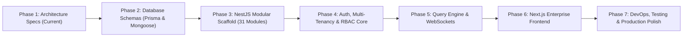

# 15. Comprehensive Multi-Phase Implementation Roadmap

## 1. Project Phase Overview

---

## 2. Phase Breakdown & Deliverables

### Phase 1: Architecture Documentation & System Design (CURRENT)
- **Status**: Completed / Submitted for Review.
- **Deliverables**:
  - 15 architectural documentation blueprints in `docs/architecture/`.
  - Comprehensive Mermaid diagrams covering System, Backend Modules, Frontend, PostgreSQL ER, MongoDB Schemas, Multi-Tenancy, RBAC, Query Lifecycle, Real-Time Messaging, Auth Flow, Deployment, and Database Communication Flow.
- **Exit Gate**: Formal user review and approval of the architectural foundation before proceeding to code.

---

### Phase 2: Database Schema Engineering (PostgreSQL & MongoDB)
- **Prerequisites**: Approval of Phase 1.
- **Deliverables**:
  - Production-grade `schema.prisma` covering all 22+ relational entities with composite unique indexes, cascades, and enum definitions.
  - Complete Mongoose schemas and TypeScript interfaces for `Conversation`, `Message`, and `ActivityEvent` with compound indexes.
  - Initial Prisma database migration script.
  - Comprehensive database seeding script (`prisma/seed.ts`) generating default System Roles, System Permissions, Standard Query Categories, and SaaS Subscription Tiers.
- **Verification**: `npx prisma validate`, migration dry-run on PostgreSQL 16 container, Mongoose schema compilation without TypeScript errors.

---

### Phase 3: Modular NestJS Backend Foundation
- **Prerequisites**: Phase 2 completion.
- **Deliverables**:
  - NestJS project initialization with TypeScript strict mode and clean folder structure.
  - Core cross-cutting infrastructure: Global exception filter, Logging interceptor, Standard validation pipes, and Config validation via Joi/Zod.
  - Implementation of all 31 business feature modules with explicit controllers, services, and DTOs.
  - Swagger / OpenAPI documentation auto-generation at `/api/docs`.
- **Verification**: Clean build (`npm run build`) without cyclic dependencies or unresolved imports.

---

### Phase 4: Authentication, Multi-Tenancy & RBAC Implementation
- **Prerequisites**: Phase 3 completion.
- **Deliverables**:
  - Argon2id password hashing implementation.
  - JWT strategy with rotating refresh tokens stored in PostgreSQL with reuse detection.
  - `TenantResolutionMiddleware` (subdomain & header parsing) and `AsyncLocalStorage` tenant context.
  - Tenant-aware Prisma extension auto-injecting `tenantId` into queries and mutations.
  - Dynamic `PermissionGuard` and `@RequirePermissions()` decorator.
  - Super Admin impersonation guard and audit trail logger.
- **Verification**: Automated tenant data isolation unit and e2e integration tests (verifying that Tenant A cannot read Tenant B's data).

---

### Phase 5: Query Management & Real-Time Engine
- **Prerequisites**: Phase 4 completion.
- **Deliverables**:
  - Query ticket creation, category routing, auto-assignment to faculty based on workload.
  - Dual-write orchestration between PostgreSQL (query state) and MongoDB (conversation stream) using the Transactional Outbox pattern.
  - SLA management service with automated escalation cron triggers.
  - Socket.IO gateway with Redis Pub/Sub adapter, JWT authentication, and tenant/query room isolation.
  - AWS S3 presigned URL generation and secure attachment processing.
- **Verification**: Real-time multi-client chat verification over WebSockets and SLA breach calculation tests.

---

### Phase 6: Next.js Frontend Portal Development
- **Prerequisites**: Phase 5 completion.
- **Deliverables**:
  - Next.js 14+ App Router project setup with Bootstrap 5, SCSS, and responsive layouts.
  - Subdomain-aware edge routing middleware.
  - Centralized Axios client with automatic 401 token refresh queue.
  - TanStack Query v5 integration with query invalidation and optimistic mutations.
  - Interactive Query Ticket Center with live chat interface, public reply vs internal note tabs, typing indicators, and real-time read receipts.
  - Role-specific dashboards for Students, Faculty, HODs, College Admins, and SaaS Super Admins.
- **Verification**: End-to-end student-to-faculty query resolution flow executed in browser.

---

### Phase 7: Docker, Redis, Testing, CI/CD & Deployment
- **Prerequisites**: Phase 6 completion.
- **Deliverables**:
  - Multi-stage Dockerfiles (`Dockerfile.backend`, `Dockerfile.frontend`, `Dockerfile.worker`).
  - Production `docker-compose.prod.yml` with Nginx reverse proxy, PostgreSQL, MongoDB replica set, and Redis.
  - GitHub Actions CI/CD workflows for linting, typechecking, Vitest tests, and container publishing.
  - Health checks (`@nestjs/terminus`) and monitoring readiness.
- **Verification**: Single-command startup (`docker compose up -d`) resulting in fully operational, isolated multi-tenant environment.
