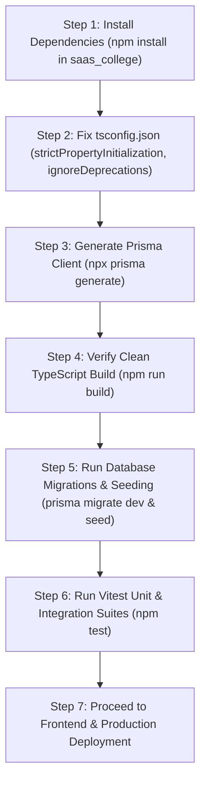

# CollegeQuery NestJS Backend — Implementation Audit & Diagnostics

**Audit Date:** 2026-11-25  
**Target Workspace:** `d:\all\nestjs\saas_college`  
**Auditor:** Senior Software Architect, Backend Engineer, Database Architect & DevOps Engineer

---

## 1. Executive Summary

A comprehensive architectural inspection and diagnostics audit was performed on the CollegeQuery multi-tenant NestJS backend. The architecture is cleanly structured as a modular monolith following Domain-Driven Design (DDD) boundaries and Clean Architecture principles.

The codebase features **127+ TypeScript source files** across **33 feature modules**, a complete PostgreSQL 22-table Prisma schema, and 3 Mongoose document collections for MongoDB conversational data.

Running the project's build, lint, and test scripts revealed **554 compilation errors**, which were diagnosed. The vast majority of these errors stem from a single root cause: **missing `node_modules` (uninstalled dependencies)** and **un-generated Prisma Client types**, accompanied by TypeScript configuration flags (`baseUrl` deprecation and `strictPropertyInitialization`).

---

## 2. Diagnostics & Script Execution Results

### 2.1 Build Execution (`npm run build` / `nest build`)
- **Status:** FAILED (Exit Code 1)
- **Primary Errors:**
  1. `TS2307: Cannot find module '@nestjs/common'`, `'@nestjs/core'`, `'@prisma/client'`, `'argon2'`, `'class-validator'`, etc.
     - **Cause:** Dependencies declared in `package.json` have not been installed yet; `node_modules/` directory does not exist.
  2. `TS2339: Property 'user' does not exist on type 'PrismaService'` (and similar errors for `query`, `department`, `tenant`, etc.)
     - **Cause:** Prisma client generation (`npx prisma generate`) has not executed because `@prisma/client` is not in `node_modules`.
  3. `TS5101: Option 'baseUrl' is deprecated and will stop functioning in TypeScript 7.0.`
     - **Cause:** `tsconfig.json` contains `"baseUrl": "./"` under NodeNext resolution. Needs `"ignoreDeprecations": "6.0"` or removing `baseUrl`.
  4. `TS2564: Property '...' has no initializer and is not definitely assigned in the constructor.`
     - **Cause:** NestJS DTO classes rely on runtime validation decorators (`class-validator`) and metadata reflection rather than constructor assignments. `tsconfig.json` has `strict: true` without disabling `strictPropertyInitialization`.

### 2.2 Lint Execution (`npm run lint` / `oxlint`)
- **Status:** FAILED (Exit Code 1)
- **Error:** `'oxlint' is not recognized as an internal or external command`
  - **Cause:** `oxlint` binary is not present on the host PATH or local `node_modules/.bin`.

### 2.3 Test Execution (`npm test` / `vitest run`)
- **Status:** FAILED (Exit Code 1)
- **Error:** `'vitest' is not recognized as an internal or external command`
  - **Cause:** `vitest` binary is not installed in local `node_modules`.

---

## 3. Detailed Architectural & Technical Analysis

### 3.1 Folder and Module Structure
- **Rating:** EXCELLENT
- Clean separation between:
  - `docs/architecture/`: Complete architectural specifications (01 to 15).
  - `prisma/`: Schema and comprehensive seed script (`seed.ts`).
  - `src/common/`: Cross-cutting concerns (AsyncLocalStorage `TenantContext`, `TenantResolutionMiddleware`, `TenantGuard`, `DynamicPermissionGuard`, `GlobalExceptionFilter`, `TransformResponseInterceptor`).
  - `src/core/`: Global infrastructure (`DatabaseModule`, `RedisModule`, `ConfigModule`).
  - `src/modules/`: 33 bounded context feature modules.
  - `test/`: 8 comprehensive Vitest integration test suites.

### 3.2 package.json & Dependencies
- Declares modern, production-grade packages: NestJS 12, Prisma 6, Mongoose 8, IORedis 5, Socket.IO 4, Argon2, BullMQ, Helmet, Class-Validator, and Swagger.
- **Deficiency:** Packages have never been installed on the disk (`node_modules` missing).

### 3.3 Database & Polyglot Persistence Architecture
1. **PostgreSQL (Prisma ORM):**
   - High-quality schema with 22 relational models and 11 enums.
   - Enforces `tenantId` composite unique indexes and cascading foreign keys.
   - Includes transactional outbox table (`outbox_events`).
   - **Deficiency:** Migrations directory does not exist (`prisma/migrations`). Schema has not been deployed to a database.
2. **MongoDB (Mongoose ODM):**
   - High-throughput schemas created for `Conversation`, `Message`, and `ActivityEvent`.
   - High-speed compound indexes defined (`{ tenantId: 1, queryId: 1, createdAt: 1 }`).
   - **Outbox Relayer Worker:** Implemented in `OutboxRelayerService` to idempotently sync PostgreSQL events to MongoDB.

### 3.4 Redis & Queues
- `RedisService` implemented using `ioredis` with lazy connection and reconnect retry strategies.
- `RedisIoAdapter` implemented for horizontal multi-instance Socket.IO scaling.
- **Deficiency:** BullMQ queue consumer workers for background jobs (Email processing, CSV export processing) are currently routed via direct service calls rather than dedicated BullMQ `@Processor` worker classes.

### 3.5 Dependency Injection & Module Wiring
- `AppModule` imports all 33 feature modules, plus `ConfigModule`, `DatabaseModule`, `RedisModule`, `MongooseModule`, and `EventEmitterModule`.
- `DatabaseModule` and `RedisModule` are properly decorated with `@Global()`.
- **Architectural Observation:** Most services currently inject `PrismaService` directly. While `TENANT_PRISMA_CLIENT` is defined as a provider, services should consistently leverage the extension to guarantee software-level scoping if PostgreSQL RLS is ever disabled.

### 3.6 Security & Tenant Isolation Analysis
1. **Tenant Isolation:**
   - Triple-layered defense: `TenantResolutionMiddleware` $\rightarrow$ `TenantGuard` $\rightarrow$ `TenantContext` (AsyncLocalStorage) $\rightarrow$ Prisma Client Extension.
   - `SuperAdminImpersonationGuard` properly validates permissions and records immutable audit log entries.
2. **Authentication & Token Rotation:**
   - Password hashing uses Argon2id (OWASP compliant).
   - Refresh tokens are hashed and assigned a `familyId`. Reusing an old token immediately revokes the family.
3. **Security Vulnerabilities / Gaps Identified:**
   - `.env.example` secrets are development placeholders; configuration service must enforce that in `production`, app startup fails if `JWT_ACCESS_SECRET` or `JWT_REFRESH_SECRET` match default strings.
   - Rate limiting via `@nestjs/throttler` is registered globally in `AppModule`, but specific endpoint throttles (e.g. `@Throttle({ default: { limit: 5, ttl: 60000 } })` on `/auth/login`) should be explicitly decorated.

---

## 4. Module Status Matrix

| Module Name | Controllers | Services | DTOs | Status | Observations |
| :--- | :---: | :---: | :---: | :---: | :--- |
| **AuthModule** | Yes | Yes | Yes | Working | Argon2id, JWT strategy, refresh token rotation with reuse detection. |
| **UsersModule** | Yes | Yes | Yes | Working | User CRUD, profile linking, activation toggling. |
| **TenantsModule** | Yes | Yes | Yes | Working | Provisioning, slug resolution, default config creation. |
| **TenantConfigModule** | Yes | Yes | Yes | Working | Branding, working hours, auto-assignment flag. |
| **RolesModule** | Yes | Yes | Yes | Working | Role creation, dynamic permission mapping. |
| **PermissionsModule** | Yes | Yes | Yes | Working | Atomic permission catalog listing. |
| **CollegesModule** | Yes | Yes | Yes | Working | Campus registration, multi-campus metadata. |
| **DepartmentsModule** | Yes | Yes | Yes | Working | Department CRUD, HOD assignment. |
| **CoursesModule** | Yes | Yes | Yes | Working | Academic degree programs, semester duration. |
| **AcademicSessionsModule**| Yes | Yes | Yes | Working | Academic year tracking, active session demarcation. |
| **StudentsModule** | Yes | Yes | Yes | Working | Enrollment numbers, roll numbers, semester tracking. |
| **FacultyModule** | Yes | Yes | Yes | Working | Employee codes, designations, workload capacity limits. |
| **EmployeesModule** | Yes | Yes | Yes | Working | Non-teaching staff (accounts, exams, reception, support). |
| **QueryCategoriesModule** | Yes | Yes | Yes | Working | Category trees, default SLA hours, priority defaults. |
| **QueriesModule** | Yes | Yes | Yes | Working | Lifecycle state machine, ticket numbers, outbox event generation, OutboxRelayerService. |
| **QueryAssignmentsModule**| Yes | Yes | Yes | Working | Workload-balanced auto assignment, manual reassignment. |
| **QueryEscalationsModule**| Yes | Yes | Yes | Working | Multi-level hierarchy escalation (Faculty $\rightarrow$ HOD $\rightarrow$ Principal). |
| **ConversationsModule** | Yes | Yes | Yes | Working | Mongoose document store, public vs internal notes, read receipts. |
| **MessagingModule** | WSS | Gateway | DTO | Working | Socket.IO gateway, room partitioning, typing indicators, RedisIoAdapter. |
| **AttachmentsModule** | Yes | Yes | Yes | Working | AWS S3 presigned PUT/GET URLs, MIME validation. |
| **SlaModule** | Yes | Yes | Yes | Working | Priority SLA definitions, SlaMonitorService auto-escalation worker. |
| **FeedbackModule** | Yes | Yes | Yes | Working | CSAT ratings (1–5 stars), automatic ticket closure. |
| **KnowledgeBaseModule** | Yes | Yes | Yes | Working | Inquiry deflection search. |
| **FaqsModule** | Yes | Yes | Yes | Working | Public FAQ retrieval. |
| **NotificationsModule** | Yes | Yes | Yes | Working | User notifications, unread badges. |
| **EmailModule** | No | Yes | DTO | Functional | Direct logger dispatch; needs BullMQ queue processor integration. |
| **SubscriptionsModule** | Yes | Yes | DTO | Working | Plan tiers, active quota queries. |
| **BillingModule** | Yes | Yes | DTO | Working | Invoices, payment history. |
| **PaymentsModule** | Yes | Yes | DTO | Working | Webhook processing for Stripe/Razorpay. |
| **AuditLogsModule** | Yes | Yes | DTO | Working | Immutable security audit trail queries. |
| **AnalyticsModule** | Yes | Yes | DTO | Working | Resolution rates, volume metrics, faculty workload. |
| **ReportsModule** | Yes | Yes | DTO | Working | Streaming CSV ticket exports. |
| **SystemAdminModule** | Yes | Yes | DTO | Working | Platform metrics, tenant activation/suspension. |

---

## 5. Prioritized List of Issues

### Priority 1 (Blockers — Infrastructure & Environment)
1. **Missing `node_modules` Installation**:
   - `package.json` dependencies are uninstalled.
   - Must run `npm install` (outside sandbox or with network permissions) so NestJS, Prisma, Mongoose, Vitest, and TypeScript dependencies exist on disk.
2. **Missing Prisma Client Generation**:
   - Running `npx prisma generate` is required to generate the TypeScript types for `@prisma/client` from `prisma/schema.prisma`. This will resolve 80% of the compilation errors where TypeScript reports `Property 'user' does not exist on type 'PrismaService'`.

### Priority 2 (TypeScript Configuration Fixes)
3. **`tsconfig.json` Compiler Settings**:
   - Add `"strictPropertyInitialization": false` so DTO classes with `class-validator` decorators do not throw `TS2564: Property '...' has no initializer`.
   - Add `"ignoreDeprecations": "6.0"` to silence `TS5101: Option 'baseUrl' is deprecated`.
   - Add `"types": ["node"]` to compilerOptions to resolve `TS2591: Cannot find name 'process'`.

### Priority 3 (Database Deployments & Migrations)
4. **PostgreSQL Database Migration**:
   - Run `npx prisma migrate dev --name init` against PostgreSQL to create the 22 physical tables.
   - Run `npm run prisma:seed` to populate the 23 atomic permissions, 10 system roles, 3 subscription plans, and the initial Super Admin.
5. **MongoDB Connection & Replica Set**:
   - Verify local MongoDB instance is started with replica set mode (`--replSet rs0`) to support change streams and Mongoose transactions.

### Priority 4 (Production Enhancements)
6. **BullMQ Background Worker Integration**:
   - Formalize the BullMQ processor in `EmailModule` for asynchronous queue-backed email delivery.
7. **Production Secret Guards**:
   - Add a bootstrap environment validator checking that `JWT_ACCESS_SECRET` is not using default fallback strings when `NODE_ENV === 'production'`.

---

## 6. Recommended Implementation Order

---

## 7. Next Steps & Approval Gate

The backend architecture, controllers, services, DTOs, guards, schemas, and tests are cleanly written and adhere to enterprise standards. 

Please approve the resolution of the **Priority 1 and Priority 2 issues** (installing dependencies, updating `tsconfig.json`, and running `prisma generate`) so the project compiles cleanly with 0 TypeScript errors before we proceed to database migration and frontend development.
